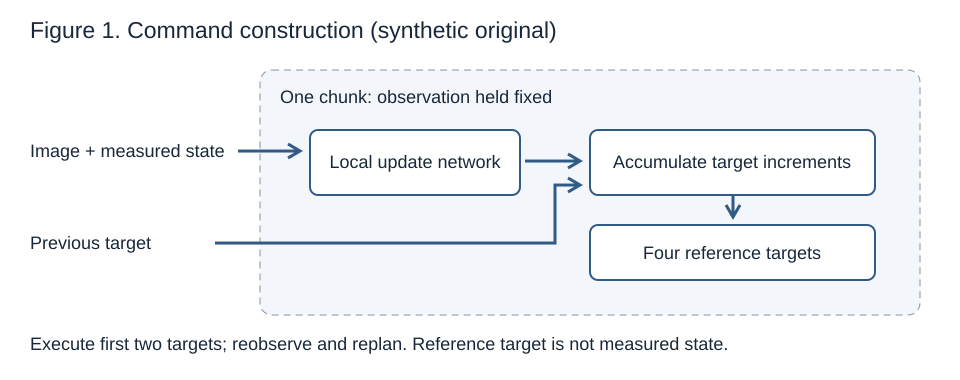

**The paper changes the starting point of command prediction: the candidate carries its previous commanded target forward and builds the next short chunk by accumulating local increments.** In the supplied tabletop task, the baseline predicts targets from the latest image and measured joint state; the candidate additionally uses the previous command. The intended benefit is to learn how to continue from that command. The paper does not claim the baseline necessarily produces discontinuities.

*Figure 1, supplied synthetic original, rendered from `synthetic-figure.svg`; the complete diagram is shown and visually inspected. Source: “Carrying a reference target: a synthetic paper,” §2, MIT-licensed evaluation material.*

Read the two incoming paths separately. **Image + measured state** conditions the local-update network; **previous target** supplies the starting reference for accumulation. The output is four reference targets. The dashed box marks an observation held fixed during construction of one chunk. This is a mechanism diagram: it has no measured trajectory or quantitative axes, and its arrows do not demonstrate tracking accuracy or stability.

For a concrete run, suppose the arm is already approaching the marked region. At a new chunk, the candidate uses the fresh observation and the previous commanded target to construct four new references. In training, squared error supervises those accumulated references against demonstration reference targets (§2). It therefore teaches command prediction, not prediction of achieved joint states. Both methods use the same 50 demonstrations and low-level controller.

At deployment, the four targets are sampled at 20 Hz; only the first two are executed before replanning, and the remaining two are replaced. Commands are interpolated to 100 Hz. These are distinct rates: 100 Hz is the command interpolation rate, not the model's inference rate. Observation refresh happens at each chunk, not at each internal increment. Inference latency and the interpolation algorithm are unreported, so these nominal rates do not establish the actual end-to-end timing.

Does this construction help learning? The decisive reported comparison is after **one training epoch**, on one held-out task. The table below reconstructs §3 Table 1's raw counts; it is not an original figure. Completion means the object reaches the marked region.

| Method | Completed trials | Evaluation size |
| --- | ---: | ---: |
| Baseline chunk prediction | 6 | 10 |
| Candidate initialized from measured state | 7 | 10 |
| Candidate initialized from previous commanded target | 8 | 10 |

This supports an observed early-training ordering under the stated conditions. The intermediate variant is consistent with the choice of starting reference mattering, but a one-trial difference without repeated seeds or uncertainty does not isolate that mechanism. The counts do not establish a learning-speed curve, final converged performance or statistical significance.

The main boundary follows directly from the command/state distinction: carrying a reference does not ensure the robot has reached it, and local increments do not by themselves guarantee smooth commands or stable motion. There is no stability theorem or closed-loop perturbation test. The single task also does not establish transfer across embodiments or contact conditions (§4).

To reread selectively, use §2 and Figure 1 to trace **what is retained, what is observed, and what is supervised**; use §3 Table 1 to judge the narrow early-training evidence; use §4 to check which deployment claims remain open. This reading covers the complete supplied synthetic paper and its original figure. It is a teaching fixture, not evidence about a real robot.
